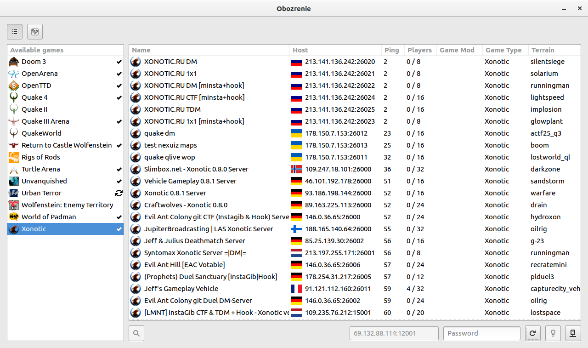

Simple and easy to use game server browser for Linux and macOS.

## Overview
Obozrenie lists multiplayer game servers and can launch the game client to connect.

## Features
- Threaded master-server queries
- GTK 3 UI
- QStat, Minetest, and Rigs of Rods adapters

## Screenshot

## Dependencies
### Required
- [Python 3.11+](https://python.org)
- [PyGObject with GTK+ 3](https://pygobject.gnome.org) (uv builds it against the system GTK stack)
- [PyXDG](https://www.freedesktop.org/wiki/Software/pyxdg/)
- [tomli-w](https://github.com/hukkin/tomli-w) (TOML writing; reading uses stdlib `tomllib`)
- [xmltodict](https://github.com/martinblech/xmltodict)
- [requests](https://requests.readthedocs.io)
- [maxminddb](https://github.com/maxmind/MaxMind-DB-Reader-python)
- [Babel](https://babel.pocoo.org)

Python packages are declared in `pyproject.toml`.

### Optional
- [QStat](https://github.com/multiplay/qstat) — QStat-backed games
- A MaxMind DB country database (`.mmdb`) — server locations as flag emoji. The app probes common system paths (e.g. `/usr/share/GeoIP/`); if none is found, the GTK frontend can download a free [DB-IP](https://db-ip.com/) country database into the user cache. No MaxMind account is required.

## Get it
### Docker
Ubuntu-based image for a quick try. No custom GTK theming, game launching, or persistent settings.

    docker pull vorot93/obozrenie
    docker run -it --rm -e LANG=$LANG -e DISPLAY=$DISPLAY -v /tmp/.X11-unix:/tmp/.X11-unix vorot93/obozrenie

### Linux / macOS (uv)
Install the native GTK 3 stack, then sync and run from the checkout.

Linux (Debian/Ubuntu):

    sudo apt install gir1.2-gtk-3.0 pkg-config libcairo2-dev libgirepository-2.0-dev

macOS:

    brew install gtk+3 gobject-introspection adwaita-icon-theme pkg-config cairo

Then:

    git clone https://github.com/vorot93/obozrenie.git
    cd obozrenie
    uv sync
    uv run obozrenie-gtk

uv compiles PyGObject and pycairo against the system GTK libraries. On macOS the launcher adds Homebrew's library directory to the dynamic loader path.

## Technical details
Python + PyGObject. Adapters query masters; core holds the game/server tables and settings; the GTK UI displays them. Data files are resolved from the source tree next to the package, or from `sys.prefix/share` when installed.

## Licenses
### Obozrenie
GNU General Public License version 3.

### Obozrenie logo
Neometric typeface by [Andres Sanchez](http://andresl.tumblr.com), CC-BY-SA-NC.
